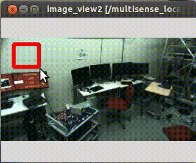
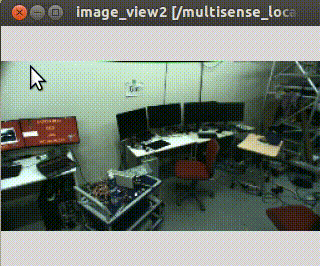
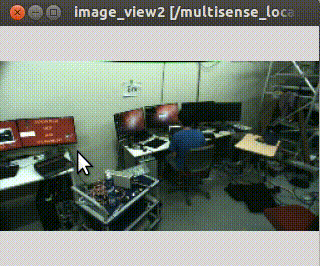
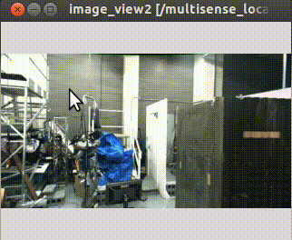
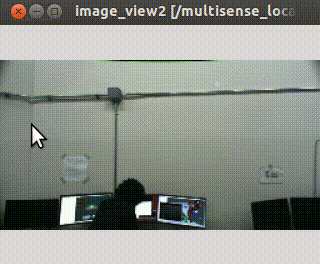
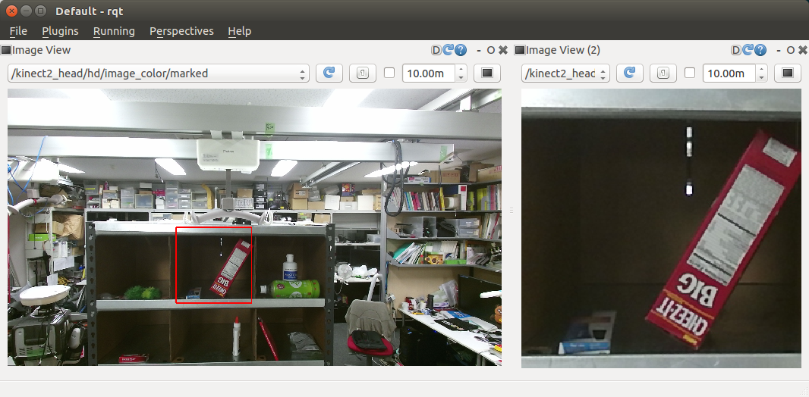

image_view2
==========


`image_view2` is an extended [image_view](http://ros.org/wiki/image_view).

Features
* Draw markers on image view
* Interact with user direction

ROS 1 / ROS 2
-------------
The package builds for both ROS 1 (catkin) and ROS 2 (ament), selected by
`$ROS_VERSION`.

| | ROS 1 | ROS 2 |
|---|---|---|
| `image_view2` executable | yes | yes |
| `points_rectangle_extractor` executable (PCL / `pcl_ros`) | yes | no |
| `scale_interaction.py` | yes (not installed, run from the source/devel space) | no |
| `sample/sample_rectangle_mouse_event.launch` | yes | no |
| `test-imageview2.l`, `test-toolframe.l` (EusLisp) | yes | no |
| dynamic reconfigure (`cfg/ImageView2.cfg`) | yes | as plain node parameters |

On ROS 2 there are no launch files; run the node with `ros2 run` and remap
`image` (and `camera_info`, if markers are drawn in 3D):

```bash
ros2 run image_view2 image_view2 --ros-args \
  -r image:=/camera/image -r camera_info:=/camera/camera_info \
  -p interaction_mode:=rectangle
```

Differences on ROS 2:

* `image_view2/ImageMarker2` is generated from `ros2/msg/ImageMarker2.msg`,
  a variant of `msg/ImageMarker2.msg` (ROS 2 field names must be lower case and
  rosidl has no `duration` type):

  | ROS 1 field | ROS 2 field |
  |---|---|
  | `position3D` | `position_3d` |
  | `points3D` | `points_3d` |
  | `duration lifetime` | `int32 lifetime_sec`, `uint32 lifetime_nsec` |

  All other fields are the same. `MouseEvent`, `PointArrayStamped` and
  `ChangeMode` are shared with ROS 1.
* The dynamic reconfigure parameters (`grid`, `fisheye_mode`, `div_u`, ...)
  are declared as node parameters and can be changed with `ros2 param set`.
* The transport of `image` is chosen with the `image_transport` parameter read
  by `image_transport` itself (e.g. `-p image_transport:=compressed`).

Interaction Modes
-----------------
image_view2 supports several modes to interact with the user.
You can set the interaction mode by the `~interaction_mode` parameter or
change the mode by service interfaces.

* Rectangle mode (`~interaction_mode:=rectangle`)

  In rectangle mode, user can select region-of-interest by dragging mouse pointer.

  

  Selected regions are published to
  `image/screenrectangle` (`geometry_msgs/PolygonStamped`) topic.

  If user clicks on the view instead of dragging pointer, clicked position
  is published to `image/screenpoint` (`geometry_msgs/PointStamped`) topic.

* Line mode (`~interaction_mode:=line`)

  In line mode, user can select a line by dragging mouse pointer.

  

  Selected line is published to `image/line` (`geometry_msgs/PolygonStamped`) topic.

* Polygon mode (`~interaction_mode:=poly`)

  In polygon mode, user can select a series of closed lines.
  User can add line by left-click and close the lines by right-click.

  

  Selected polygon is published to `image/poly` (`geometry_msgs/PolygonStamped`) topic.

* Grabcut mode (`~interaction_mode:=grabcut`)

  In grabcut mode, user can select two curves. By typing `Esc` key, you can clear
  selected curves.

  

  The selected first red curve is published to
  `image/foreground` (`sensor_msgs/Image`) and
  the second green one is published to `image/background` (`sensor_msgs/Image`).
  This mode is originally implemented to select foreground and background pixels for grabcut.

* Grabcut Rectangle mode (`~interaction_mode:=grabcut_rect`)

  In grabcut rectangle mode, user can select two rectangles. By typing `Esc` key, you can clear
  selected rectangles.

  

  The selected first red rectangle is published to
  `image/foreground_rect` (`geometry_msgs/PolygonStamped`) and
  the second green one is published to
  `image/background_rect` (`geometry_msgs/PolygonStamped`).
  This mode is originally implemented to select foreground and background regions for grabcut.

* Series mode (`~interaction_mode:=series` or `freeform`)

  The points of the dragged mouse path are published to
  `image/screenpoint_array` (`sensor_msgs/PointCloud2`).

* None mode (`~interaction_mode:=none`)

  Disables the interaction.

ROS API
-------
`image` below is the resolved name of the `image` topic, e.g.
`/camera/image/screenpoint` for `image:=/camera/image`.

### Publishing Topics

* `image/marked` (`sensor_msgs/Image`) on ROS 1, `marked` (`sensor_msgs/Image`, in the namespace of the node, e.g.
  `/marked`) on ROS 2, and `image_marked` (`sensor_msgs/Image`)

  Image with marks drawn.

* `image/screenrectangle_image` (`sensor_msgs/Image`)

  Cropped image with user selection at **Rectangle mode**.

  

* `image/screenpoint` (`geometry_msgs/PointStamped`)
* `image/screenrectangle` (`geometry_msgs/PolygonStamped`)
* `image/screenpoint_array` (`sensor_msgs/PointCloud2`)
* `image/line` (`geometry_msgs/PolygonStamped`)
* `image/poly` (`geometry_msgs/PolygonStamped`)
* `image/foreground`, `image/background` (`sensor_msgs/Image`)
* `image/foreground_rect`, `image/background_rect` (`geometry_msgs/PolygonStamped`)

  Results of the interaction modes above.

* `image/movepoint` (`geometry_msgs/PointStamped`)

  Mouse position while the left button is pressed.

### Subscribing Topics
* `image` (`sensor_msgs/Image`)

  Input image
* `camera_info` (`sensor_msgs/CameraInfo`)

  CameraInfo of the image. camera info is required to compute projection matrix
  when drawing markers.
* `image_marker` (`image_view2/ImageMarker2`)

  Marker topic.
* `image/event` (`image_view2/MouseEvent`)

  Event interface. image_view2 can handle mouse events without gui interaction.
  This topic is used to emulate event handling via ros topics

### Advertising Services
* `~change_mode` (`image_view2/ChangeMode`)

  Service interface to change interaction mode.
* `~rectangle_mode` (`std_srvs/Empty`)
* `~grabcut_mode` (`std_srvs/Empty`)
* `~grabcut_rect_mode` (`std_srvs/Empty`)
* `~line_mode` (`std_srvs/Empty`)
* `~poly_mode` (`std_srvs/Empty`)
* `~none_mode` (`std_srvs/Empty`)

  Service interface to change interaction mode with `std_srvs/Empty` service.

### Parameters
* `~interaction_mode` (`String`, default: `rectangle`)

  `rectangle`, `line`, `poly`, `grabcut`, `grabcut_rect`, `series` (or `freeform`) or `none`.
* `~use_window` (`Bool`, default: `true`)

  Show the OpenCV window. Set `false` to run without GUI (e.g. with `image/event`).
* `~window_name` (`String`, default: `image_view2 [<image topic>]`)
* `~autosize` (`Bool`, default: `false`)
* `~image_transport` (`String`, default: `raw`)
* `~skip_draw_rate` (`Int`, default: `0`)

  Number of input images skipped between drawn images.
* `~draw_grid` (`Bool`, default: `false`)
* `~blurry` (`Bool`, default: `false`)
* `~region_continuous_publish` (`Bool`, default: `false`)

  Keep publishing the last selected region on every image.
* `~filename_format` (`String`, default: `frame%04i.jpg`)

  File name of images saved from the window.
* `~show_info` (`Bool`, default: `false`)
* `~resize_scale_x`, `~resize_scale_y` (`Double`, default: `1.0`)

  Scale of the input image; selected coordinates are divided by it.
* `~tf_timeout` (`Double`, default: `1.0`)

  Timeout [sec] to look up tf for 3D markers.
* Dynamic reconfigure (ROS 1) / node parameters (ROS 2): `grid` (default: `false`),
  `fisheye_mode` (`false`), `div_u` (`10`), `div_v` (`10`), `grid_red` (`255`),
  `grid_green` (`0`), `grid_blue` (`0`), `grid_thickness` (`2`), `grid_space` (`10`)

image_view2/ImageMarker2
-----------------------
image_view2/ImageMarker2 is a message to draw on image_view2 canvas.

Definition (`msg/ImageMarker2.msg`, ROS 1; see above for the ROS 2 field names) is:
```
byte CIRCLE=0
byte LINE_STRIP=1
byte LINE_LIST=2
byte POLYGON=3
byte POINTS=4
byte FRAMES=5
byte TEXT=6

byte LINE_STRIP3D=7
byte LINE_LIST3D=8
byte POLYGON3D=9
byte POINTS3D=10
byte TEXT3D=11
byte CIRCLE3D=12

byte ADD=0
byte REMOVE=1

Header header
string ns		# namespace, used with id to form a unique id
int32 id          	# unique id within the namespace
int32 type        	# CIRCLE/LINE_STRIP/etc.
int32 action      	# ADD/REMOVE
geometry_msgs/Point position # used for CIRCLE/TEXT, 2D in pixel-coords
geometry_msgs/PointStamped position3D # used for 3DTEXT
geometry_msgs/PoseStamped pose # used for CIRCLE3D
float32 scale	 	# the diameter for a circle, etc.
float32 width	 	# the width for a line, etc.
std_msgs/ColorRGBA outline_color
byte filled		# whether to fill in the shape with color
std_msgs/ColorRGBA fill_color # color [0.0-1.0]
duration lifetime       # How long the object should last before being automatically deleted.  0 means forever
byte arc # used for CIRCLE3D
float32 angle # used for CIRCLE3D


geometry_msgs/Point[] points # used for LINE_STRIP/LINE_LIST/POLYGON/POINTS., 2D in pixel coords
PointArrayStamped points3D # used for 3DLINE_STRIP/3DLINE_LIST/3DPOLYGON/3DPOINTS
std_msgs/ColorRGBA[] outline_colors # a color for each line, point, etc.

string[] frames # used for FRAMES, tf names
string text             # used for TEXT, draw size of text is scale
bool left_up_origin     # draw text from left up origin
bool ratio_scale        #Use ratio respected to original image to specify scale and position
```

Sample
------

You can run the sample code of `image_view2` (ROS 1)

```bash
# Launch image_view2 with interactive mode
roslaunch image_view2 sample_rectangle_mouse_event.launch
# Add markers
rosrun image_view2 test-imageview2.l
```
